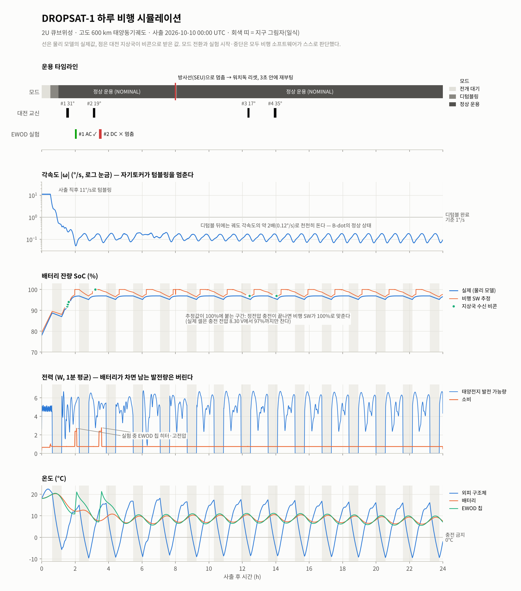
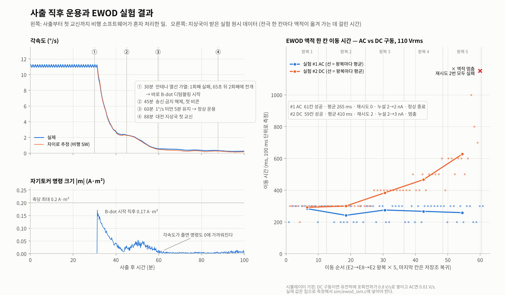

# DROPSAT-1

DROPSAT-1 위성 비행 소프트웨어와 지상국·물리 시뮬레이터입니다. C99 기반으로 전개 시퀀스, B-dot 자세제어, 전력 관리, 명령 인증, 상태 저장, EWOD 액적 실험을 구현합니다.

## 구성

| 경로 | 내용 |
| --- | --- |
| `fsw/` | 비행 소프트웨어, HAL 인터페이스, 통신 프로토콜, CRC-16 및 SipHash |
| `sim/` | 위성·궤도·전력·EWOD 물리 모델과 지상국 시뮬레이션 |
| `tests/` | 모의 HAL을 사용하는 비행 소프트웨어 테스트 |
| `tools/plot.py` | 시뮬레이션 결과 그래프 생성 |
| `out/` | 제공된 시뮬레이션 로그, CSV 및 결과 이미지 |

## 빌드 및 테스트

Linux 또는 Windows의 Ubuntu WSL에서 C 컴파일러와 GNU Make를 사용합니다.

```sh
make
make test
```

2026-10-01 Ubuntu WSL에서 기본 컴파일 옵션으로 빌드하고, 기존 테스트 실행 파일의 **133개 검사 모두 통과**를 확인했습니다. 이 검사는 모의 HAL을 사용하며 실제 하드웨어나 비행 운용 검증을 의미하지 않습니다.

## 시뮬레이션

```sh
make run HOURS=24 OUT=out
```

직접 실행하면 난수 시드, OBC 정지 사건 발생 시각, 초기 궤도 위치를 지정할 수 있습니다.

```sh
./build/dropsat_sim --hours 24 --seed 7 --seu 8 --u0 160 --out out
```

`--seu`는 사출 후 지정한 시간에 OBC를 정지시키는 시뮬레이션 설정입니다. 음수로 지정하면 이 사건을 끕니다. `make run`은 지정한 출력 폴더의 결과 파일을 다시 생성합니다.

## 그래프

Python 3, NumPy, Matplotlib이 필요합니다. 한글 그래프에는 한글 글꼴을 설치하는 것이 좋습니다.

```sh
python3 -m pip install numpy matplotlib
make plot OUT=out
```

### 제공된 24시간 시뮬레이션 결과





## 시험용 인증키

`fsw/keys.h`의 `CMD_KEY`는 공개된 시험용 값 `DROPSAT-TESTKEY1`입니다. 시뮬레이터와 테스트의 재현을 위한 값이며 실제 운용 인증키로 사용하면 안 됩니다. 실제 운용 키는 소스 저장소에 포함하지 않고 별도로 관리해야 합니다.

## 정리

`make clean`은 `build/`와 지정된 출력 폴더(기본값 `out/`)를 삭제합니다. 제공된 결과를 보존하려면 실행 전에 별도 위치에 복사하거나 다른 `OUT` 경로를 지정하세요.
